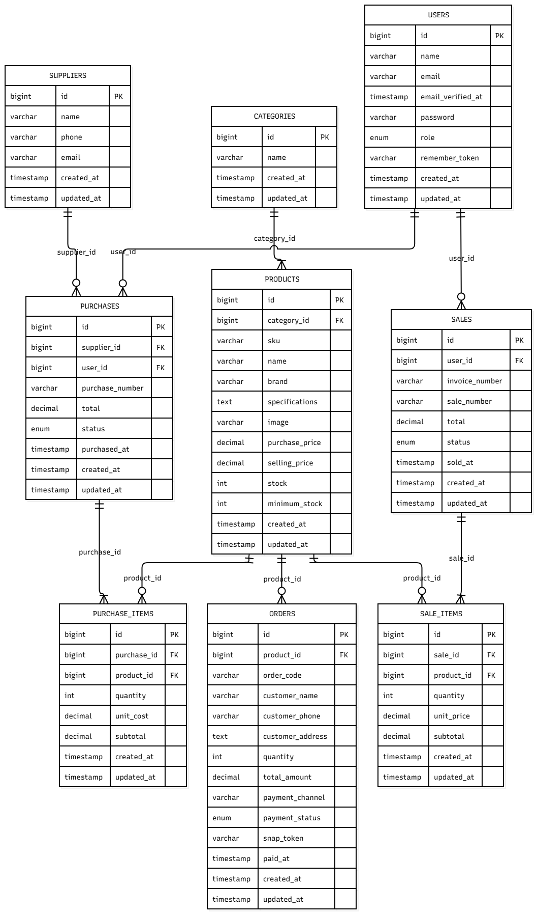

# ElectroHub - Integrated Inventory & Sales Management System

> Sistem Informasi Distribusi & Manajemen Ritel Perangkat Keras Komputer berbasis Laravel & MySQL dengan integritas transaksi atomik, validasi ketat di sisi server, dan kontrol akses berbasis peran (Role-Based Access Control).

## 1. Project Overview & Business Scenario

ElectroHub dibangun untuk mengatasi kelemahan pencatatan inventaris manual pada bisnis distribusi perangkat komputer dan laptop. Masalah umum seperti *overselling* (stok minus), ketidaksinkronan antara transaksi penjualan dan kuota fisik gudang, serta ketiadaan audit trail diselesaikan secara menyeluruh melalui:

* **Pencatatan Master Data Terstruktur:** Manajemen kategori, produk/SKU unik, dan direktori pemasok (*supplier*).

* **Omnichannel Order Management:** Pemisahan alur sistem terintegrasi antara transaksi fisik kasir (POS) dan pesanan pelanggan mandiri secara *online*, dilengkapi dengan generator resi pengiriman otomatis untuk divisi *packing*.

* **Integritas Transaksi Atomik:** Transaksi Pengadaan (*Stock-In*) dan Penjualan (*Stock-Out / POS*) dibungkus menggunakan `DB::transaction` dan `lockForUpdate()` untuk mencegah *race condition*.

* **Otorisasi Berlapis:** Pemisahan wewenang nyata pada level server (*middleware & policy*) antara peran **Owner** dan **Staff**.

* **Katalog Publik & Etalase Ritel:** Konsumen dapat melihat ketersediaan stok fisik aktual secara *real-time*.

## 2. System Requirements

Aplikasi ini dikembangkan dan diuji pada lingkungan:

* **PHP:** `^8.2` (dengan ekstensi `pdo_mysql`, `mbstring`, `openssl`, `bcmath`)

* **Framework:** Laravel `12.x`

* **Database Engine:** MySQL `8.0+` / MariaDB (Storage Engine: **`InnoDB`** wajib untuk transaksi & *foreign keys*)

* **Dependency Manager:** Composer `^2.5`

* **Node.js & NPM:** Node `^18.x` / `^20.x`

* **Web Server:** Laragon / XAMPP / Built-in PHP CLI Server

## 3. Step-by-Step Installation Guide (Reproducible Setup)

Ikuti langkah-langkah berikut untuk menjalankan repositori ini pada *environment* baru:

### Langkah 1: Klon Repositori

```bash
git clone https://github.com/username-anda/electrohub.git
cd electrohub
```

### Langkah 2: Instal Dependensi Backend

```bash
composer install
```

### Langkah 3: Konfigurasi Environment File

Salin file template `.env.example` menjadi `.env`:

```bash
cp .env.example .env
```

Buka file `.env` dan pastikan konfigurasi koneksi database Anda sesuai:

```env
APP_NAME=ElectroHub
APP_ENV=local
APP_KEY=
APP_DEBUG=true
APP_URL=http://127.0.0.1:8000

DB_CONNECTION=mysql
DB_HOST=127.0.0.1
DB_PORT=3306
DB_DATABASE=electrohub
DB_USERNAME=root
DB_PASSWORD=
```

### Langkah 4: Generate Application Key

```bash
php artisan key:generate
```

### Langkah 5: Migrasi Database & Seeding Data Awal

Pastikan layanan database MySQL Anda sudah berjalan aktif, lalu eksekusi migrasi bersih beserta seeder:

```bash
php artisan migrate:fresh --seed
```

*Perintah ini akan menyusun seluruh 9 tabel bisnis dan menginjeksi master data awal (kategori, produk bervariasi harga & stok, data pemasok, dan akun demo).*

### Langkah 6: Kompilasi Aset Frontend (Bila Menggunakan Vite)

```bash
npm install
npm run build
```

### Langkah 7: Hubungkan Storage Gambar & Jalankan Server

```bash
php artisan storage:link
php artisan serve
```

Akses aplikasi melalui peramban di: `http://127.0.0.1:8000`

## 4. Demo Accounts & Role Permissions

| Peran (Role) | Email Login | Password Default | Batasan Hak Akses (Server-Side Protected) |
| --- | --- | --- | --- |
| **Owner / Admin** | `owner@electrohub.com` | `password` / `password1` | Akses penuh: Kelola staf/user, CRUD master data, input Stock-In & Sales, pembatalan transaksi, audit laporan finansial eksekutif. |
| **Staff / Kasir** | `staff@electrohub.com` | `password` / `password123` | Input transaksi pembelian (*Stock-In*), melayani kasir (*Sales*), cek ketersediaan stok produk. Ditolak dari menu manajemen akun dan penghapusan data master. |
|**Customer / Customer** | `customer@electrohub.com` | `password` / `password123` |

## 5. Database Architecture & Entity Relationship Diagram (ERD)

Struktur basis data dirancang dengan normalisasi penuh (3NF) dan menggunakan storage engine **InnoDB** untuk menjamin *referential integrity* melalui relasi *Foreign Key* dan *Cascading Rules*.

### Visual Diagram ERD



### Struktur Relasi Tabel

```text
                    +--------------+             +--------------+
                    |  CATEGORIES  |             |  SUPPLIERS   |
                    +-------+------+             +-------+------+
                            | 1                          | 1
                            | hasMany                    | hasMany
                            v N                          v N
+--------------+    +-------+------+             +-------+------+
|    USERS     |    |   PRODUCTS   |             |  PURCHASES   |
+-------+------+    +---+---+---+--+             +-------+------+
        | 1             |   |   |                        | 1
        |               |   |   +----------+             | hasMany
        | hasMany       |   | hasMany      | hasMany     v N
        v N             |   v N            v N    +--------------+
+--------------+        | +------------+ +-------+|PURCHASE_ITEMS|
|    SALES     |        | | SALE_ITEMS | | ORDERS|+--------------+
+-------+------+        | +------------+ +-------+
        | 1             |       ^
        | hasMany       +-------+
        v N
+--------------+
|  SALE_ITEMS  |
+--------------+
### Rincian 9 Tabel Inti:

1. **`users`**: Menyimpan kredensial (`name`, `email` unique, `password` hashed, `role` [owner/staff]).
2. **`categories`**: Klasifikasi produk hardware (`name` unique).
3. **`products`**: Data fisik barang (`category_id`, `sku` unique, `purchase_price`, `selling_price`, `stock`, `minimum_stock`).
4. **`suppliers`**: Direktori mitra pemasok resmi (`name`, `phone`, `email`).
5. **`purchases`**: Faktur *Header* transaksi pengadaan (*stock-in*) barang masuk (`supplier_id`, `user_id`, `purchase_number` unique, `total`, `purchased_at`).
6. **`purchase_items`**: Detail *Item* barang masuk (`purchase_id`, `product_id`, `quantity`, `unit_cost`, `subtotal`).
7. **`sales`**: Faktur *Header* transaksi kasir (*stock-out*) ritel (`user_id`, `sale_number` unique, `total`, `sold_at`).
8. **`sale_items`**: Detail *Item* belanja kasir (`sale_id`, `product_id`, `quantity`, `unit_price`, `subtotal`).
9. **`orders`**: Pencatatan pesanan checkout dari etalase publik.

### Relasi Eloquent Antarmodel:

* `Category` **hasMany** `Product` | `Product` **belongsTo** `Category`
* `Supplier` **hasMany** `Purchase` | `Purchase` **belongsTo** `Supplier`
* `Purchase` **hasMany** `PurchaseItem` | `PurchaseItem` **belongsTo** `Purchase`
* `Product` **hasMany** `PurchaseItem` | `PurchaseItem` **belongsTo** `Product`
* `User` **hasMany** `Sale` | `Sale` **belongsTo** `User`
* `Sale` **hasMany** `SaleItem` | `SaleItem` **belongsTo** `Sale`
* `Product` **hasMany** `SaleItem` | `SaleItem` **belongsTo** `Product`

*Seluruh kueri pada index menggunakan **Eager Loading** (contoh: `Product::with('category')->paginate(10)`) untuk mengeliminasi masalah performa **N+1 Query**.*

## 6. Core Business Logic & Security Implementation

Aplikasi ini mengimplementasikan aturan bisnis dan standar keamanan data transaksi sebagai berikut:

1. **Perhitungan Finansial Wajib di Sisi Server:**
   Input harga satuan (`unit_price`) dari form browser diabaikan. Controller selalu menarik harga resmi langsung dari database (`$product->selling_price`) sebelum mengalikannya dengan kuantitas yang divalidasi.

2. **Pencegahan Overselling & Konkurensi (Row-Level Locking):**
   Setiap transaksi penjualan memanggil `Product::lockForUpdate()->findOrFail(...)` di dalam blok `DB::transaction`. Jika kuantitas transaksi melebihi sisa stok aktual, sistem langsung melempar pengecualian validasi dan menggagalkan transaksi.

3. **Integritas Transaksi Atomik (Rollback Guarantee):**
   Penyimpanan tabel *header*, tabel *detail items*, dan perintah `$product->decrement('stock', $qty)` dieksekusi dalam satu siklus `DB::transaction`. Jika salah satu item gagal, seluruh perubahan dibatalkan otomatis (*all-or-nothing*).

4. **Perlindungan Riwayat Transaksi (No Hard Deleting):**
   Data produk yang memiliki riwayat transaksi di `sale_items` atau `purchase_items` dicegah dari aksi penghapusan permanen (`destroy()`) untuk menjaga integritas pembukuan dan relasi *Foreign Key*.

5. **Otorisasi Server-Side:**
   Rute krusial (seperti manajemen akun dan staf) dilindungi oleh middleware otorisasi. Pengguna dengan peran *Staff* akan mendapatkan status **403 Forbidden** atau dialihkan bila mencoba membuka URL `/users` secara langsung.

## 7. Test Scenarios & Results (Uji Fungsional & Kasus Ekstrem)

| No | Modul / Skenario Pengujian | Aksi Uji | Ekspektasi Sistem | Status Hasil |
| --- | --- | --- | --- | --- |
| 1 | **Authentication** | Login dengan password salah atau email belum terdaftar. | Sistem menolak akses dan memunculkan error validasi. | **PASS** |
| 2 | **Master Data Validation** | Menambahkan produk dengan SKU yang telah terdaftar. | Ditolak oleh *unique database constraint* dan validasi Laravel. | **PASS** |
| 3 | **Stock-In (Pembelian)** | Memproses faktur PO pembelian baru dengan kuantitas 4 unit. | Stok produk di database bertambah tepat 4 unit, total PO terekap. | **PASS** |
| 4 | **Stock-Out (Penjualan)** | Memproses transaksi kasir pada produk dengan kuantitas valid. | Stok produk berkurang otomatis, faktur invoice terbit, omzet terupdate. | **PASS** |
| 5 | **Insufficient Stock (Overselling)** | Mencoba menjual 9 unit pada produk yang hanya memiliki sisa 8 unit. | Transaksi digagalkan total, stok tidak berkurang, pesan error muncul. | **PASS** |
| 6 | **Integrity Protection** | Menghapus produk yang telah memiliki riwayat penjualan aktif. | Tombol hapus dicegat di server, database melempar notifikasi proteksi. | **PASS** |
| 7 | **Staff Route Authorization** | Akun staf mencoba mengakses URL `/users` secara manual. | Server menolak akses staf dan mengalihkan dengan proteksi hak akses. | **PASS** |
| 8 | **Filter & Pagination** | Menavigasi filter kategori hardware dan paginasi halaman 2. | Data terfilter akurat dan query string parameter tetap dipertahankan. | **PASS** |
| 9 | **Web Checkout & Fulfillment** | Melakukan pemesanan mandiri dari etalase web publik. | Pesanan masuk ke tabel `orders` dengan kode `ORD-`, validasi `quantity` tersembunyi berhasil, dan admin dapat mencetak resi termal tanpa *sidebar* UI. | **PASS** |

## 8. Known Limitations

* **Payment Simulation:** Sistem kasir ritel dan checkout publik menggunakan simulasi pembayaran instan (belum menghubungkan *webhook* produksi payment gateway perbankan nyata).
* **Single Warehouse:** Pengelolaan stok masih dioptimalkan untuk sistem pergudangan terpusat (*single location inventory*).

## 9. Profil Pengembang

* **Pengembang:**
* **Peran:** Full Stack Developer
* **Repositori:**
* **Kontak / Portofolio:** 
